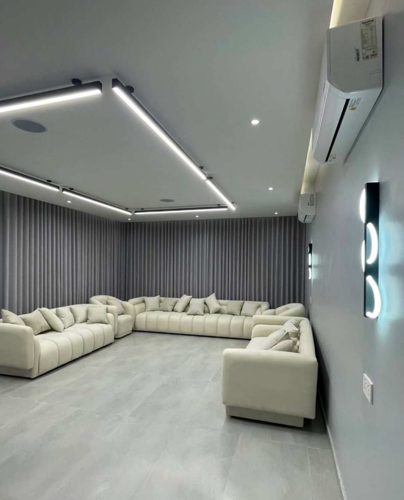

الديوانية في الملحق تختلف عن مجلس البيت الداخلي: غالباً تطل على الشارع، ونوافذها تواجه الشمس، وتُستخدم في جلسات طويلة مساءً. والستارة تحل هذه الأمور.

## الحرارة

الملحق غالباً مبنى مستقل تضربه الشمس من أكثر من جهة. قماش كثيف أو [بلاك اوت](/curtains/blackout/) يقلل حرارة الشمس على الجلسة نهاراً.

## الخصوصية من الشارع

نوافذ الديوانية قريبة من الشارع غالباً. الخط المعتم ليلاً ضروري، والشيفون نهاراً. شرحنا ذلك في [الغرف المطلة على الشارع](/blog/street-facing-room-curtains/).

## الصدى

الديوانية الكبيرة بأرضية رخام فيها صدى. القماش الكثيف يخفف الصدى قليلاً، لكنه ليس عازلاً للصوت.

## الشكل

- ويفي على سكة مخفية لديوانية مودرن.
- كورنيش مع ستارة لديوانية كلاسيكية.

شاهد [ويفي رمادي مع شيفون في ديوانية بحولي](/projects/hawalli-wave-grey-sheer-diwaniya/)، واقرأ [ستائر المجالس والديوانيات](/blog/diwaniya-majlis-curtains/).
