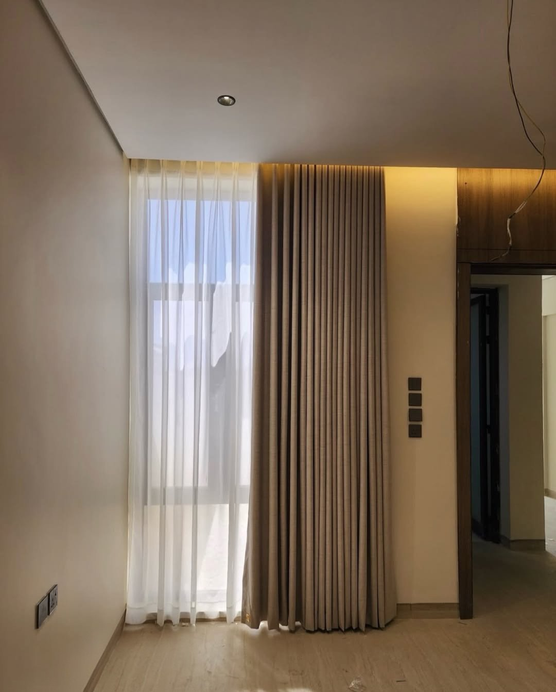

الستارة الكهربائية تُفتح وتُغلق بالريموت أو التطبيق. لكنها ليست ضرورية لكل نافذة، فمتى تستحق؟

## متى تستحق؟

- **النوافذ العالية** التي يصعب الوصول إليها، مثل الصالات ذات السقف المرتفع.
- **الواجهات الطويلة** التي يتعب سحب ستارتها يدوياً.
- **غرف النوم** لمن يريد التحكم من السرير.

## متى لا تحتاجها؟

النوافذ العادية في المطبخ والحمام، والنوافذ التي تُفتح نادراً. هنا الستارة اليدوية تكفي.

## ماذا تجهز قبل التركيب؟

نقطة كهرباء قريبة من طرف السكة. ويفضّل تجهيزها قبل الجبس في البيوت الجديدة. وراجع [تجهيز البيت قبل يوم التركيب](/blog/before-curtain-installation-day/).

## السعر

يعتمد على المقاس ونوع الموتور، لذلك نرسل عرض السعر بعد الزيارة.
