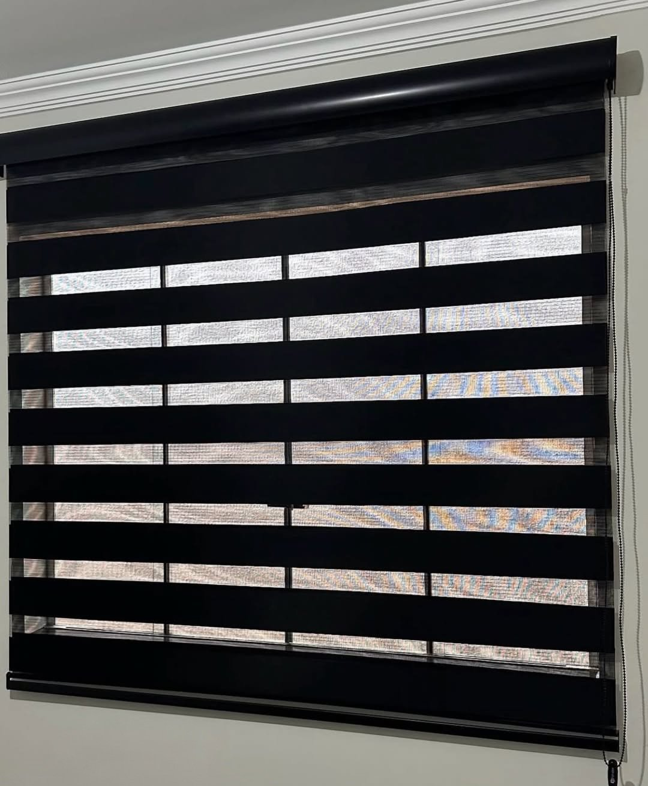
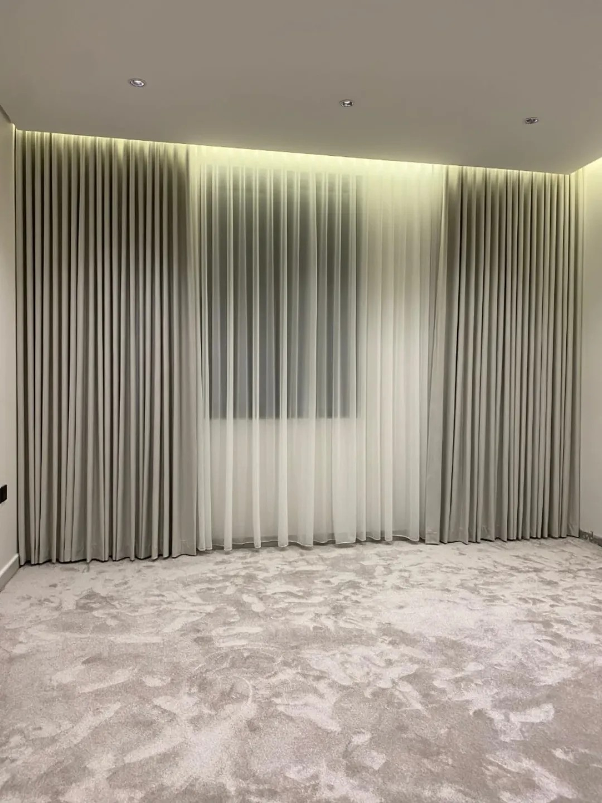

عند اختيار ستائر غرف نوم (أو «ستاير غرف نوم» كما يكتبها كثيرون)، فأفضل ستارة هي التي تجمع **العتمة ليلاً** و**الخصوصية نهاراً**. وأكثر الحلول عملية: ستارة بلاك اوت لحجب الضوء، ومعها طبقة شيفون تسمح بضوء النهار دون أن يرى أحد الداخل. وإن كانت النافذة صغيرة أو أردت مظهراً بسيطاً، فرول بلاك اوت وحده يكفي.

## ما الذي تحتاجه غرفة النوم تحديداً؟

- **عتمة للنوم:** خاصة لمن ينام نهاراً أو تواجه نافذته إنارة الشارع.
- **خصوصية:** إذا كانت النافذة تطل على جار أو شارع.
- **تحكم بالضوء:** أن تختار بين ضوء خفيف وعتمة كاملة دون تبديل الستارة.

## أي الخيارات أنسب؟

| الخيار | العتمة | الخصوصية نهاراً | السعر |
|---|---|---|---|
| [رول بلاك اوت](/curtains/blackout/) | عالية | عند إنزاله فقط | 6 د.ك/م² |
| ويفي مع بلاك اوت (طبقة واحدة) | عالية | عند إغلاقه فقط | 6 د.ك/م² |
| خام بلاك اوت مع شيفون | عالية | نعم، بالشيفون | 9 د.ك/م² |
| [شيفون](/curtains/sheer/) وحده | منخفضة | جزئية | 5 د.ك/م² |

السعر يشمل القماش والسكة والتفصيل، والتركيب مجاني عند طلب 5 ستائر فأكثر، وأقل من ذلك يُضاف 5 د.ك لكل ستارة. وتجد كل الأنواع في [أسعار الستائر](/prices/).

## الزيبرا (ليلي نهاري) لغرفة النوم

إن أردت التحكم بالضوء والخصوصية دون رفع الستارة، فالزيبرا رول بطبقتين بشرائح شفافة ومعتمة متناوبة: تحرّك السلسلة فتتطابق الشرائح ليدخل الضوء، أو تتعاكس للستر. سعرها 9 د.ك للمتر المربع. التفاصيل في [ستائر الزيبرا](/curtains/zebra/).

من أعمالنا: [ستارة زيبرا سوداء لغرفة نوم بالعاصمة](/projects/capital-zebra-black-bedroom/).

## ألوان أقمشة البلاك اوت المتوفرة

من أقمشتنا بلاك اوت بملمس الكتان يبدو من الداخل كقماش طبيعي، بألوان من الأبيض والرمادي الفاتح والأخضر الباهت إلى البيج والرمادي الداكن، وبلاك اوت عازل للشمس بنسيج متعرج بدرجات الرمادي. وتُعرض العينات كاملة في زيارة القياس. التفاصيل في [ستائر بلاك اوت](/curtains/blackout/).

## كيف تمنع تسرب الضوء من الأطراف؟

حتى القماش البلاك اوت يسمح بمرور الضوء من حوله إذا كانت الستارة بمقاس النافذة تماماً. لذلك:

- اجعل الستارة القماشية أعرض من النافذة، وأعلى منها إن أمكن.
- مع السقف الجبس، ركّب السكة داخل الكورنيش ليُغلق الفراغ العلوي.
- في الرول، يُقاس العرض بحسب التركيب داخل فتحة النافذة أو فوقها، وهذا ما نحدده في زيارة القياس.

## مثال من أعمالنا

في [ستائر ويفي رمادية مع شيفون لغرفة نوم](/projects/wave-grey-sheer-bedroom/)، ركّبنا ستائر ويفي رمادية على جانبي الجدار وطبقة شيفون بيضاء أمام النافذة: الشيفون للنهار، والطبقة القماشية تُسحب عند الحاجة للعتمة والستر.

## أمثلة أخرى من غرف نوم نفّذناها

- [ويفي بلاك اوت بيج مع شيفون لغرفة نوم](/projects/blackout-wave-beige-sheer-bedroom/): سكتان مخفيتان في السقف، الشيفون للنهار والبلاك اوت للنوم.
- [ستارة ويفي بلاك اوت لنافذة عالية](/projects/blackout-wave-beige-tall-room/) من السقف إلى الأرض.
- [ستائر ويفي مع شيفون لغرفة في النسيم](/projects/nasim-room-wave-sheer/) بطبقتين على نافذتين.

## ماذا عن غرف الأطفال؟

لغرف الأطفال قماش مطبوع بتصاميم مناسبة لهم بسعر 6 د.ك للمتر المربع. راجع [ستائر الأطفال](/curtains/kids/).

## كيف تطلب ستائر غرفة النوم؟

1. أرسل صورة النافذة ومقاسها التقريبي عبر واتساب لعرض سعر مبدئي.
2. زيارة منزلية مجانية لأخذ المقاسات وعرض العينات (عدا العبدلي والصبية فالمعاينة فيهما مدفوعة).
3. نفصّل الستائر في ورشتنا في الضجيج خلال يومين إلى 3 أيام حسب الكمية، ثم [نركّبها](/services/installation/) في موقعك.

## أسئلة شائعة

**هل البلاك اوت يحجب الضوء بالكامل؟** القماش يحجب الضوء المار من خلاله، أما الضوء من الأطراف فيعتمد على المقاس وطريقة التركيب.

**هل أختار رولاً أم ويفي لغرفة النوم؟** الرول مرتب ويأخذ مساحة أقل، والويفي يعطي طيات قماشية. اقرأ [الفرق بين ستائر الرول والستائر القماشية](/blog/roll-vs-fabric-curtains/).

**كم تكلفة ستارة غرفة نوم؟** نافذة 2 × 2.5 م (5 م²) برول بلاك اوت: 30 د.ك، ومع التركيب لأقل من 5 ستائر: 35 د.ك.

**متى أحتاج سكة مزدوجة؟** عندما تريد طبقتين معاً: بلاك اوت للعتمة وشيفون للنهار. اقرأ [متى تحتاج سكة مزدوجة مع شيفون؟](/blog/double-track-with-sheer/).
