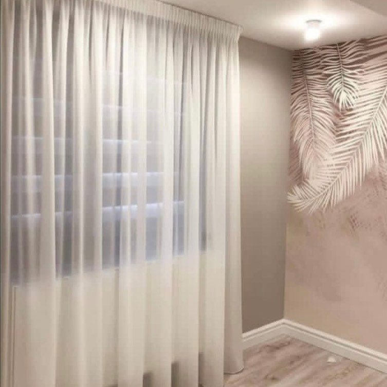

الستارة الخفيفة تمرر ضوء النهار وتخفف الرؤية من الخارج. ويُختار لها غالباً أحد قماشين: **الشيفون** أو **الكتان الشفاف**.

## الشيفون

- ناعم وخفيف وشفاف.
- يمرر ضوءاً أكثر.
- يناسب الصالات المودرن والنوافذ الكبيرة.

## الكتان الشفاف

- ملمس طبيعي وخيوط واضحة.
- مظهر أدفأ وأكثر هدوءاً.
- يناسب الصالات الكلاسيكية والمجالس.

شاهد مثالاً في [كتان شفاف أبيض بزاوية](/projects/wave-linen-shafaf-abyad-zawiya-work/).

## الخصوصية ليلاً

الستارة الخفيفة لا تكفي وحدها ليلاً، لأن إضاءة الغرفة تُظهر الداخل. لذلك نجمعها مع خط قماش معتم على [سكة مزدوجة](/blog/double-track-with-sheer/).

## الأسعار

- [ستائر شيفون](/curtains/sheer/) وحدها: **5 د.ك للمتر المربع**.
- خطين (قماش + شيفون): **19 د.ك للمتر الطولي**.
