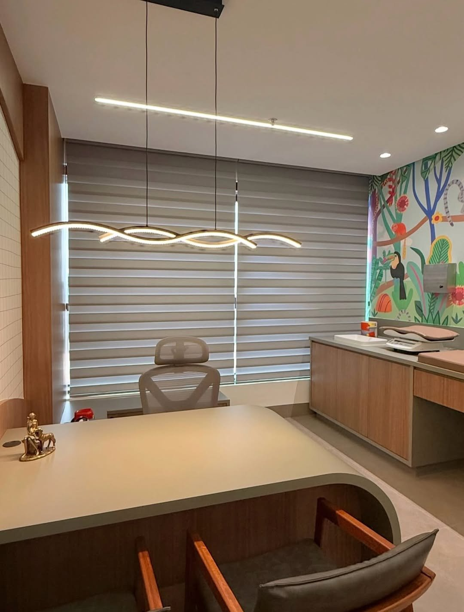

العيادة والصالون مكانان تجاريان لكن فيهما خصوصية للعملاء. والستارة فيهما تجمع بين المظهر المرتب والخصوصية وسهولة التنظيف.

## غرف الفحص والخدمة

تحتاج خصوصية كاملة في كل وقت. [الزيبرا](/curtains/zebra/) تضبط الضوء والخصوصية بحبل واحد، و[الرول](/curtains/roll/) المعتم يغلق النافذة كاملاً. شاهد [زيبرا رمادي في عيادة بالعاصمة](/projects/capital-zebra-grey-clinic/).

## الاستقبال

الواجهة الزجاجية في الاستقبال تحتاج تخفيف الوهج دون حجب المكان. [العمودية](/curtains/vertical/) أو الرول الشفاف مناسبان.

## التنظيف

الرول والزيبرا والعمودية تُمسح بقطعة قماش، وهذا مهم في الأماكن التي تحتاج نظافة مستمرة.

## الأسعار

| النوع | السعر |
|---|---|
| رول | 8 د.ك/م² |
| زيبرا | 9 د.ك/م² |
| عمودية | 12 د.ك/م² |

وقارنّا بين الأنواع في [ستائر المكاتب والشركات](/blog/office-curtains-roll-vertical-zebra/).
