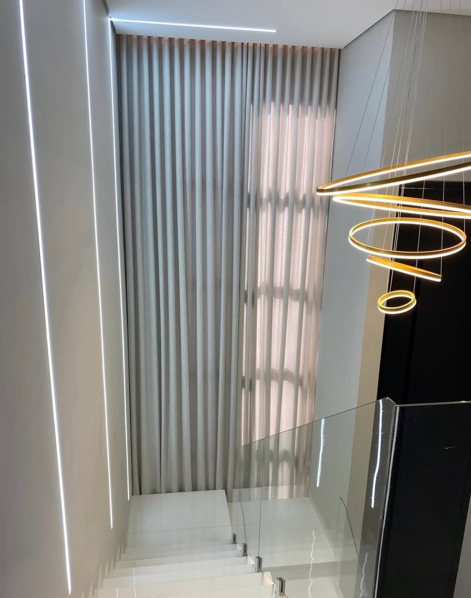

نوافذ الدرج والممرات صعبة لأنها عالية أو ضيقة أو في مكان مرور. وهذه حلول نفّذناها في بيوت الكويت.

## نافذة الدرج

النافذة الطويلة على الدرج تُدخل شمساً قوية على المدخل. نركّب [الويفي](/curtains/wave/) على سكة من السقف حتى أسفل النافذة، فتغطي الارتفاع كاملاً بقطعة واحدة. شاهد [ستائر ويفي رمادي على نافذة درج](/projects/hawalli-wave-grey-staircase/).

## الممر الزجاجي

في الممرات الضيقة لا مكان لطيات القماش، فيكون [الرول](/curtains/roll/) هو الأنسب لأنه يلتصق بالنافذة. شاهد [رول أبيض في ممر زجاجي](/projects/hawalli-roll-white-glass-corridor/).

## ستارة فاصل بين الممر والصالة

إذا أردت فصل الممر عن الصالة دون جدار، فستارة ويفي على سكة في السقف تُسحب عند الحاجة. مثال: [فاصل ممر رمادي بيجي في أبو حليفة](/projects/wave-fasil-mamarr-ramadi-bieji-abu-halifa-work/).

## نصائح للقياس

- قِس الارتفاع من السقف إلى الأرض أو إلى أسفل النافذة في أكثر من نقطة، لأن الدرج يغيّر المسافة.
- أخبرنا بارتفاع السقف حتى نحضر السلم المناسب.

اقرأ أيضاً [كيف تقيس نافذتك](/blog/how-to-measure-window/).
