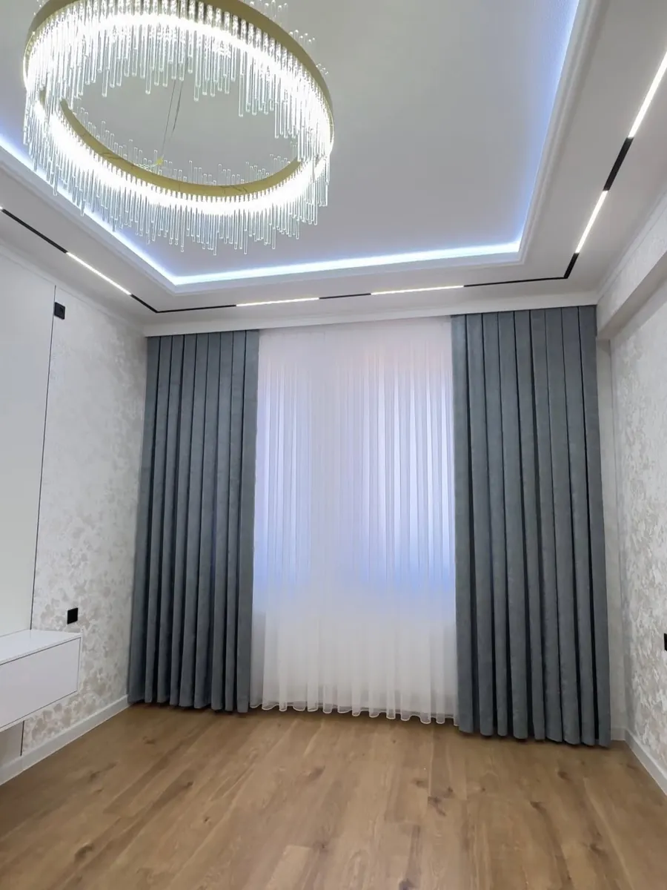

اختيار لون الستارة أسهل مما يبدو إذا بدأت من أكبر قطعة في الغرفة: **الكنب** أو **الجدار**. الستارة تغطي مساحة كبيرة، فلونها يغيّر إحساس الغرفة كلها.

## ثلاث قواعد سهلة

1. **درجة أفتح أو أغمق من الكنب:** كنب رمادي فاتح مع ستارة رمادية أغمق قليلاً، أو كنب بيج مع ستارة أوف وايت.
2. **ستارة محايدة مع كنب ملوّن:** إذا كان الكنب أخضر أو كحلي، اجعل الستارة بيج أو رمادي فاتح حتى يبقى الكنب هو محور الغرفة.
3. **اللون الثالث في المخدات:** إذا أردت ربط الستارة بالكنب، اختر مخدات تجمع اللونين.

## الجدار والأرضية

- **الأرضية الرخامية الفاتحة:** تناسبها الستائر الفاتحة والمتوسطة.
- **الجدار الأبيض:** أي لون يبرز عليه، فاختر حسب الكنب.
- **الجدار الملوّن:** اختر ستارة محايدة حتى لا يتزاحم لونان قويان.

## انتبه للإضاءة

اللون يتغير بين ضوء النهار والإضاءة الصفراء ليلاً. لذلك نعرض العينات في زيارة أخذ المقاسات، فتراها بجانب الكنب في إضاءة غرفتك نفسها.

## الشيفون يخفف أي لون

إذا ترددت بين لونين، فالخط الثاني من الشيفون الأبيض يخفف اللون الغامق في النهار. اطلع على [أنواع الستائر في الكويت](/blog/curtain-types-kuwait/) لتختار النوع قبل اللون.
