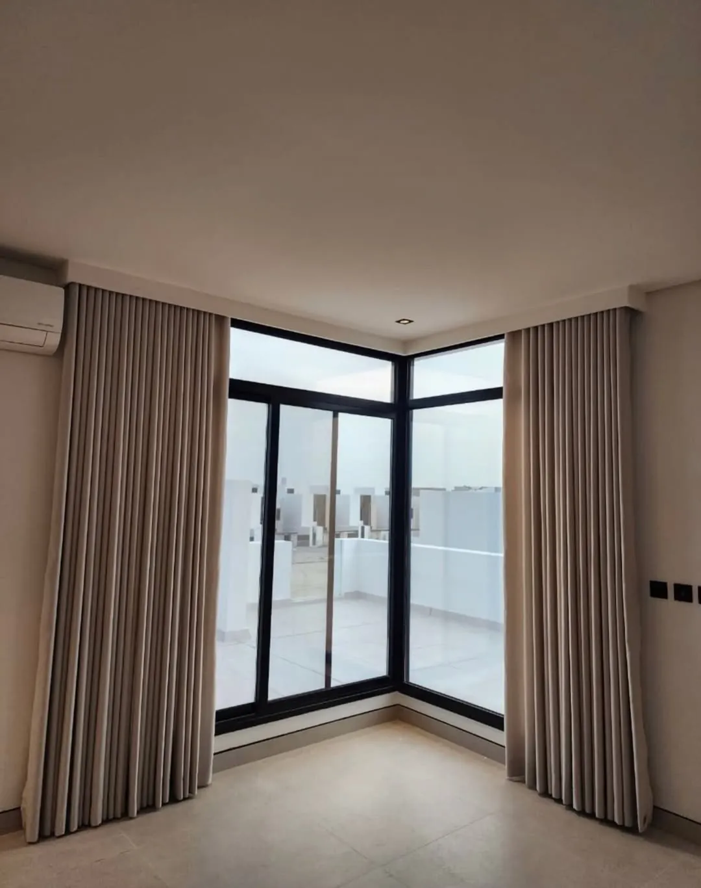

السكة تحدد شكل الستارة بقدر ما يحدده القماش. وهذه الأنواع الثلاثة الأكثر استخداماً في بيوت الكويت.

## السكة المخفية في الجبس

تُركّب داخل جيب في السقف الجبس، فتبدو الستارة نازلة من السقف مباشرة. هي الخيار الأول مع [الويفي](/curtains/wave/)، وتسمح بسكة مزدوجة للقماش والشيفون معاً.

## السكة الظاهرة على السقف

تُثبت مباشرة على السقف عندما لا يوجد جيب جبس. عملية وسريعة التركيب، وتناسب البيوت المسكونة التي لا تريد أعمال جبس جديدة.

## الكورنيش الخشبي

إطار خشبي أعلى النافذة يُخفي السكة، ويعطي مظهراً كلاسيكياً للمجالس والصالات التقليدية. شاهد مثالاً في [ستائر ويفي مع شيفون تحت كورنيش](/projects/wave-sheer-cornice-living/).

## وماذا عن العمود؟

العمود الظاهر للستائر [بالحلقات](/curtains/eyelet/) فقط، والحلقات لا تعمل على السكة. وشرحنا الفرق في [ويفي أم حلقات](/blog/wave-vs-eyelet-curtains/).

## كيف تختار؟

| الحالة | السكة المناسبة |
|---|---|
| بيت جديد قبل الجبس | مخفية في الجبس |
| سقف جاهز بلا جيب | ظاهرة على السقف |
| مجلس كلاسيكي | كورنيش |
| ستارة حلقات | عمود |
