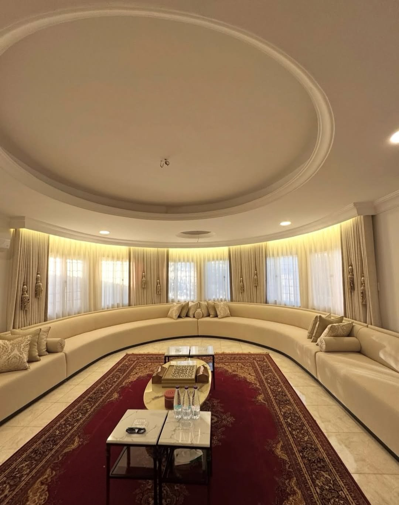

لا يوجد «أفضل نوع ستائر» واحد لكل البيوت، فالأفضل هو النوع المناسب للغرفة: كم ضوءاً تريد، وهل تحتاج خصوصية، وهل الستارة قرب ماء أو مطبخ. هذا الدليل يلخّص الأنواع التي نفصّلها في الكويت، وأين يناسب كل منها، وسعر المتر المربع لكل نوع شاملاً القماش والسكة والتفصيل.

## الستائر القماشية

- **[ستائر ويفي](/curtains/wave/)** (6 د.ك/م²): طيات موجية متساوية على سكة خاصة، وتناسب الصالات والمجالس والنوافذ الطويلة.
- **[ويفي مع شيفون (الخام)](/wave-curtains/)** (7 د.ك/م²): طبقتان على سكة واحدة، شيفون يمرر ضوءاً ناعماً نهاراً وقماش يغلق النافذة مساءً.
- **ستائر الحلقات** (6 د.ك/م²): حلقات على عمود ظاهر لمظهر كلاسيكي.
- **[ستائر شيفون](/curtains/sheer/)** (5 د.ك/م²): قماش خفيف شفاف للضوء والخصوصية النهارية، وحده أو خلف ستارة أخرى.
- **[ستائر بلاك اوت](/curtains/blackout/)** (6 د.ك/م²، و9 د.ك/م² للخام بلاك اوت مع شيفون): لحجب الضوء في غرف النوم والنوافذ المشمسة.
- **[ستائر رومانية](/curtains/roman/)** (7 د.ك/م²): قماش يرتفع بطيات أفقية فوق بعضها.

## ستائر الرول والبليندات

- **[ستائر رول](/curtains/roll/)** (6 د.ك/م²): قماش مسطّح يُلَفّ على أنبوب، للمطابخ والحمامات وغرف النوم والمكاتب. وإن كانت مقاسات الجاهز تناسبك فلدينا [ستائر رول جاهزة](/ready-roll-curtains/).
- **[ستائر زيبرا (ليلي نهاري)](/curtains/zebra/)** (9 د.ك/م²): شرائط شفافة ومعتمة متبادلة، تتحكم بالضوء دون رفع الستارة.
- **[ستائر خشبية](/curtains/wooden/)** (13 د.ك/م²): شرائح خشبية تُمال لمظهر دافئ، وتناسب المطابخ والصالات.
- **[ستائر مكتبية](/curtains/office/)** (6 د.ك/م²): للمكاتب والعيادات والواجهات الزجاجية.
- **[ستائر أطفال](/curtains/kids/)** (6 د.ك/م²، و13 د.ك/م² للتصميم المطبوع حسب الطلب).

## أي نوع لكل غرفة؟

| الغرفة | الأنسب غالباً | السبب |
|---|---|---|
| الصالة والمجلس | ويفي مع شيفون | مظهر قماشي متناسق وضوء ناعم نهاراً |
| غرفة النوم | بلاك اوت، أو خام بلاك اوت مع شيفون | حجب الضوء للنوم مع خيار نهاري |
| المطبخ | رول أو خشبي | بعيدة عن الموقد والماء وسهلة المسح |
| الحمام | رول | عملية في المساحات الصغيرة |
| المكتب | رول مكتبي أو زيبرا | تحكم بالضوء على الشاشات والواجهات |
| غرفة الأطفال | ستائر أطفال أو بلاك اوت | ألوان مناسبة ونوم أهدأ |

هذه اقتراحات عامة، ونقترح عليك الأنسب لكل نافذة في زيارة القياس المجانية (عدا العبدلي والصبية فالمعاينة فيهما مدفوعة)، حيث نعرض العينات في إضاءة غرفتك.

## ماذا يشمل السعر؟

سعر المتر المربع يشمل القماش والسكة والتفصيل، وأقمشتنا تركية. والتركيب مجاني عند طلب 5 ستائر فأكثر، وأقل من ذلك 5 د.ك لكل ستارة. قدّر مبلغ نوافذك من [حاسبة الأسعار](/prices/)، واقرأ عن الخطوات في [تفصيل ستائر حسب المقاس](/services/tailoring/) و[تركيب ستائر في الكويت](/services/installation/).

## أسئلة شائعة

**ما أفضل نوع ستائر للصالة؟** غالباً الويفي مع الشيفون، لأنه يجمع مظهر الطيات القماشية مع ضوء ناعم نهاراً، وسعره 7 د.ك للمتر المربع.

**ما أفضل نوع ستائر لغرفة النوم؟** البلاك اوت لحجب الضوء، أو الخام بلاك اوت مع شيفون (9 د.ك/م²) إن أردت طبقة نهارية أيضاً.

**هل الرول أرخص من الويفي؟** السعر نفسه تقريباً: 6 د.ك/م² لكليهما، والفرق في الشكل وطريقة التحكم بالضوء. قارن بينهما في [الفرق بين ستائر الرول والستائر القماشية](/blog/roll-vs-fabric-curtains/).

للمزيد شاهد [أعمالنا](/projects/) أو [تواصل معنا](/contact/) عبر واتساب.
