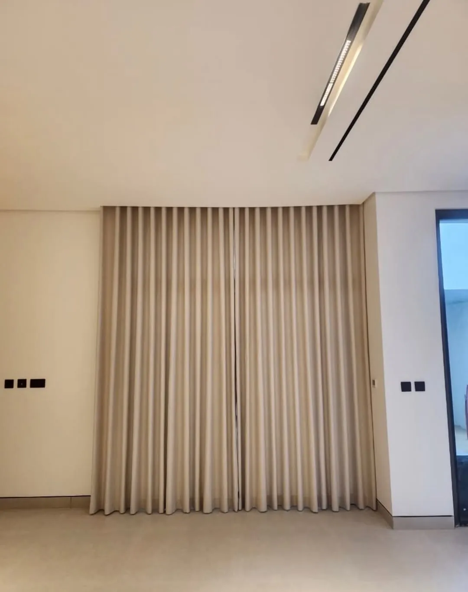

جيب الجبس فتحة في السقف بجانب الجدار تختفي فيها سكة الستارة، فتبدو الستارة نازلة من السقف مباشرة. ولأنه جزء من السقف، يجب أن يُجهز أثناء أعمال الجبس، لا بعدها.

## خط واحد أم خطين؟

قرر قبل الجبس: هل تريد ستارة واحدة، أم قماشاً مع شيفون على [سكة مزدوجة](/blog/double-track-with-sheer/)؟ الخطان يحتاجان جيباً أعرض.

## ماذا تخبر مقاول الجبس؟

1. عدد خطوط الستارة لكل غرفة.
2. أن يمتد الجيب بعرض الجدار كاملاً إذا أردت ستارة تغطي الجدار.
3. للستائر الكهربائية: نقطة كهرباء داخل الجيب أو بجانبه.

وأفضل طريقة أن تتواصل معنا قبل الجبس، لنخبرك بما يناسب نوع الستارة.

## إذا انتهى الجبس بلا جيب

لا مشكلة: نركّب سكة ظاهرة على السقف، أو كورنيشاً يُخفيها. شرحنا الخيارات في [أنواع سكة الستائر](/blog/curtain-track-types/). شاهد [ويفي على سكة مخفية](/projects/wave-khatt-wahid-beige-sakka-mukhfiya-work/).
