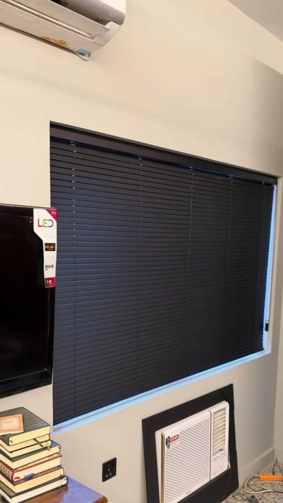

الشتر الداخلي شرائح أفقية تدور لتنظيم الضوء، وتُرفع بالحبل عند الحاجة. ونفصّل منه نوعين: [ألمنيوم](/curtains/metal/) و[خشب](/curtains/wooden/). ونقدّم الشتر الداخلي فقط، لا شتر الواجهات الخارجية.

## الألمنيوم

- **لا يتأثر بالرطوبة**، فيناسب المطابخ والحمامات.
- **خفيف وسهل التنظيف** بقطعة قماش.
- مظهر عملي يناسب المكاتب.
- السعر: **15 د.ك للمتر المربع**.

## الخشب

- **مظهر أدفأ** يناسب الصالات وغرف الجلوس.
- يحتاج إبعاده عن الماء المباشر.
- السعر: **13 د.ك للمتر المربع**.

## أيهما تختار؟

| المكان | الأنسب |
|---|---|
| المطبخ والحمام | ألمنيوم |
| المكتب | ألمنيوم |
| الصالة وغرفة الجلوس | خشب |

وللمطابخ تحديداً اقرأ [ستائر المطبخ](/blog/kitchen-curtains/).
