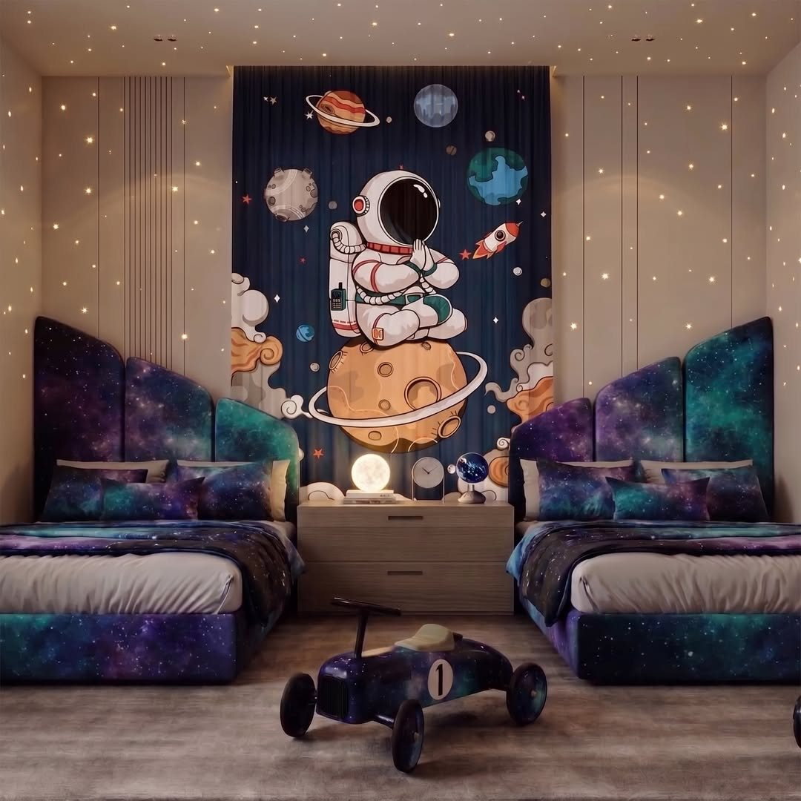

غرفة الطفل تحتاج ستارة تساعده على النوم في الظهيرة، وتكون آمنة وسهلة التنظيف. وهذه أهم النقاط.

## العتمة لنوم الظهيرة

شمس الكويت قوية طوال النهار، والطفل الصغير ينام في الظهيرة. لذلك نوصي بقماش [بلاك اوت](/curtains/blackout/) يحجب الضوء، سواء كانت الستارة رول أو ويفي.

## الرول المطبوع

يمكن طباعة رسمة على [ستارة الرول](/curtains/roll/): فضاء، سيارات، حيوانات، أو ألوان هادئة. والرول سهل المسح ولا يجمع الغبار مثل القماش. شاهد [ستائر غرف الأطفال](/curtains/kids/).

## الأمان مع الحبال

- نثبت الحبل على الجدار بقطعة تمنع تدلّيه.
- لا تضع سرير الطفل تحت النافذة مباشرة.

## الألوان

- **للأولاد:** الأزرق الفاتح والرمادي والأخضر الهادئ.
- **للبنات:** الوردي الفاتح والبيج واللافندر.
- **لون محايد** يكبر مع الطفل إذا لم ترد تغيير الستارة بعد سنوات.

## الأسعار

- رول أطفال: **6 د.ك للمتر المربع**.
- رول مطبوع برسمة: **13 د.ك للمتر المربع**.
- ويفي خط واحد: **12 د.ك للمتر الطولي**.
