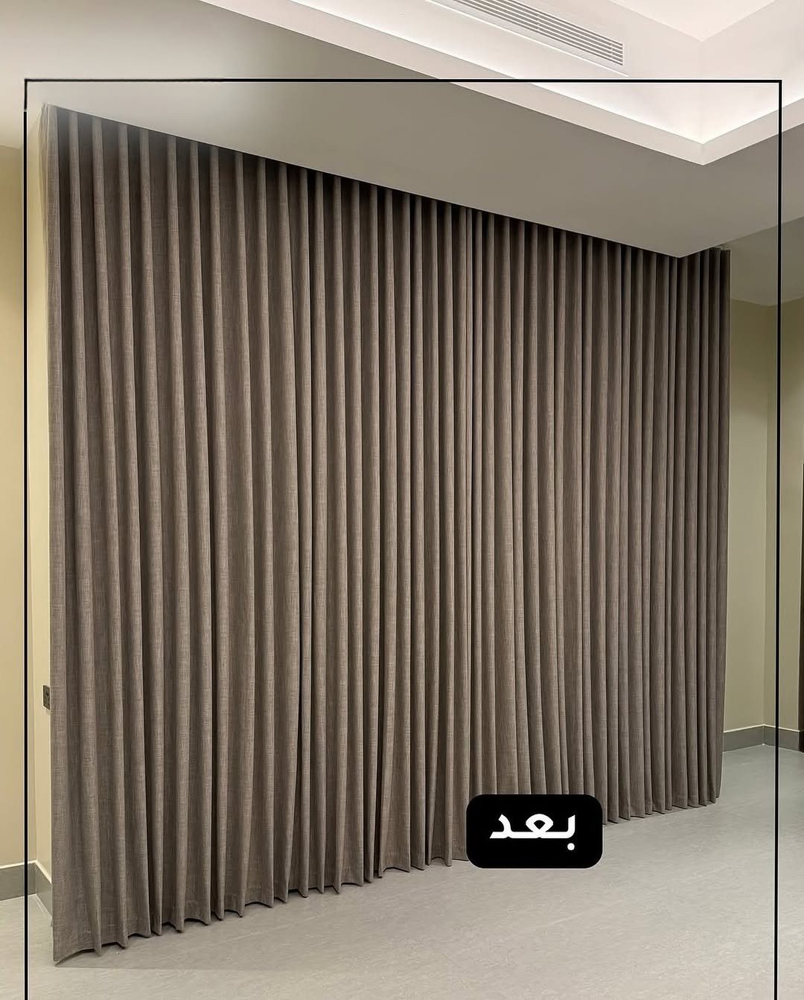

الواجهة الزجاجية تعطي إطلالة وضوءاً، لكنها تُدخل حرارة الشمس وتكشف الداخل. والستارة المناسبة تحل الأمرين.

## الويفي من السقف

الحل الأكثر طلباً: سكة واحدة بطول الجدار، والستارة من السقف للأرض. تنسحب كاملة للجانب نهاراً. شاهد [واجهة زجاجية قبل وبعد الويفي](/projects/mubarak-glass-facade-wave/).

## الرول المقسّم

إذا كانت الواجهة مقسمة بإطارات ألمنيوم، نفصّل رولاً لكل قسم، فتتحكم في كل جزء وحده. شاهد [رول على واجهة زجاجية](/projects/mubarak-roll-glass-facade/).

## العمودية

للمكاتب والأبواب المنزلقة، والشرائح تدور لتوجيه الضوء. اطلع على [الستائر العمودية](/curtains/vertical/).

## الحرارة والخصوصية

- من جهة الشمس: قماش [بلاك اوت](/curtains/blackout/) أو كثيف.
- للنهار: خط شيفون.
- للواجهات العالية: الستائر الكهربائية توفر عناء الفتح اليدوي.
