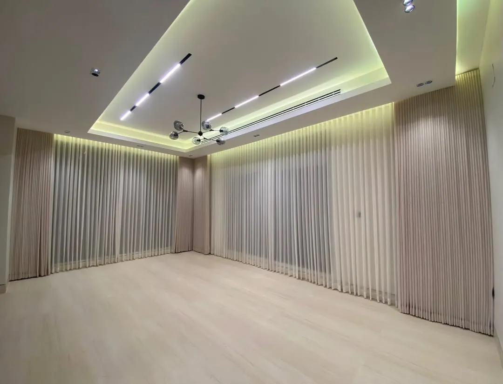

الصالة المودرن تعتمد على الخطوط البسيطة والألوان الهادئة، والستارة فيها جزء من التصميم وليست مجرد غطاء للنافذة. وأكثر ما نفصّله لصالات الكويت المودرن هو **الويفي على سكة مخفية في الجبس**، بطيات موجية متساوية من السقف حتى الأرض.

## الأنواع المناسبة للصالة المودرن

- **[الويفي](/curtains/wave/):** طيات متساوية ومظهر مرتب سواء كانت مفتوحة أو مغلقة، ويُخفى الشريط في الكورنيش.
- **الويفي خطين مع الشيفون:** القماش للخصوصية ليلاً، والشيفون يمرر ضوء النهار بنعومة. شرحنا الفكرة في [السكة المزدوجة مع الشيفون](/blog/double-track-with-sheer/).
- **[الرول](/curtains/roll/):** للنوافذ الصغيرة أو الجانبية في الصالة، ويُركّب داخل فتحة النافذة.

## الألوان التي تناسب الأثاث المودرن

- **البيج والرمادي الفاتح:** يناسبان الأرضيات الرخامية الفاتحة والكنب الرمادي أو البيج، ويُظهران الصالة أوسع.
- **الموكا والبني الفاتح:** يعطيان دفئاً مع الخشب والإضاءة الصفراء.
- **لون أغمق من الجدار بدرجة:** قاعدة بسيطة تجعل الستارة واضحة دون أن تطغى على المكان.

## نصيحة للصالات ذات السقف الجبس

ابدأ الستارة من السقف مباشرة وغطِّ الجدار كاملاً لا النافذة فقط. هذا يرفع السقف بصرياً ويُخفي اختلاف أحجام النوافذ. شاهد مثالاً في [ستائر ويفي تغطي جدار صالة كاملاً](/projects/wave-beige-full-wall-living-room-work/).

## الأسعار

- ويفي خط واحد: **12 د.ك للمتر الطولي**.
- ويفي خطين مع شيفون: **19 د.ك للمتر الطولي**.
- رول: **8 د.ك للمتر المربع**.

أرسل صورة الصالة ومقاس الجدار عبر واتساب، ونزورك لأخذ المقاسات وعرض الألوان.
