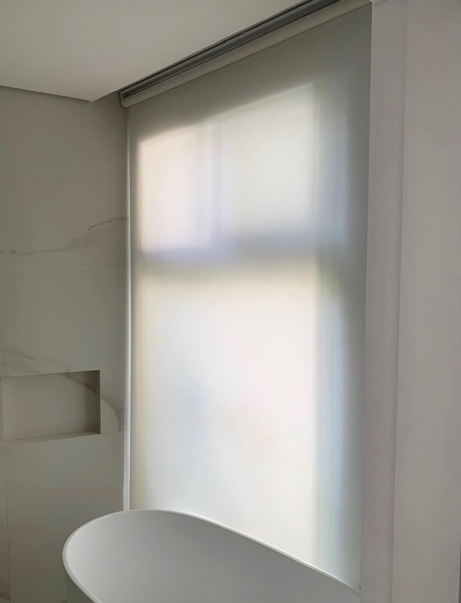

الشقة الجديدة تحتاج ستائر لكل النوافذ مرة واحدة، والتخطيط يوفر الوقت والمال. هذه طريقة مرتبة للبدء.

## غرفة بغرفة

| الغرفة | النوع المقترح |
|---|---|
| الصالة | ويفي خطين مع شيفون |
| غرفة النوم | ويفي أو رول بلاك اوت |
| غرفة الأطفال | رول بلاك اوت |
| المطبخ | رول أو شتر ألمنيوم |
| الحمام | رول |

## القياس قبل الأثاث أم بعده؟

القياس ممكن في أي وقت، لكن اختيار اللون أسهل عندما تعرف لون الكنب. ونعرض العينات في الزيارة. اقرأ [كيف تقيس نافذتك](/blog/how-to-measure-window/).

## الميزانية

- ويفي خط واحد: **12 د.ك للمتر الطولي**.
- ويفي خطين: **19 د.ك للمتر الطولي**.
- رول: **8 د.ك للمتر المربع**.
- التركيب مجاني عند 5 ستائر فأكثر.

ولتقدير أدق اقرأ [كم تكلفة الستائر في الكويت](/blog/curtain-cost-kuwait/).
