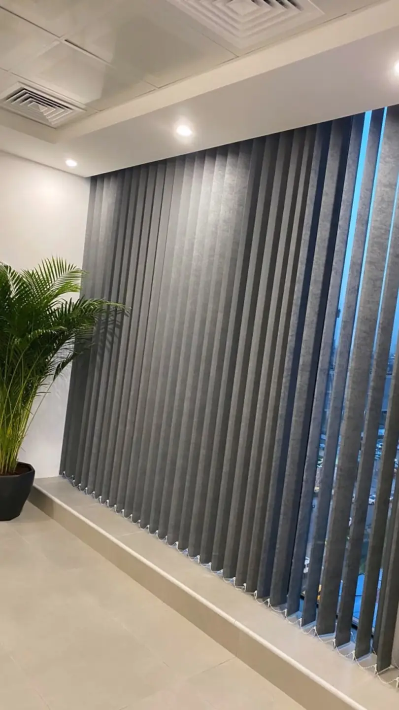

ستائر المكتب تحتاج أن تكون عملية قبل أي شيء: تخفف وهج الشمس على الشاشات، وتبقى مرتبة، ويسهل تنظيفها. وهذه الأنواع الثلاثة الأكثر طلباً.

## الستائر العمودية الشريطية

شرائح عمودية تدور لتوجيه الضوء وتنسحب للجانب. مناسبة للواجهات الزجاجية العريضة والأبواب المنزلقة. السعر **12 د.ك للمتر المربع**. شاهد [الستائر العمودية](/curtains/vertical/).

## الرول

قطعة واحدة تُلف للأعلى، بمظهر بسيط يناسب المكاتب الحديثة. متوفر بقماش شفاف يخفف الوهج أو بلاك اوت لغرف الاجتماعات. السعر **8 د.ك للمتر المربع**.

## الزيبرا

طبقتان بخطوط شفافة ومعتمة تتحرك فوق بعضها، فتتحكم في الضوء تدريجياً. السعر **9 د.ك للمتر المربع**. شاهد مثالاً في [زيبرا رمادي لعيادة](/projects/capital-zebra-grey-clinic/).

## مقارنة سريعة

| | العمودية | الرول | الزيبرا |
|---|---|---|---|
| الواجهات العريضة | ممتازة | تحتاج عدة قطع | تحتاج عدة قطع |
| التحكم بالضوء | تدوير الشرائح | رفع وإنزال | تدريجي |
| السعر للمتر المربع | 12 د.ك | 8 د.ك | 9 د.ك |

للمزيد اطلع على [ستائر المكاتب](/curtains/office/).
