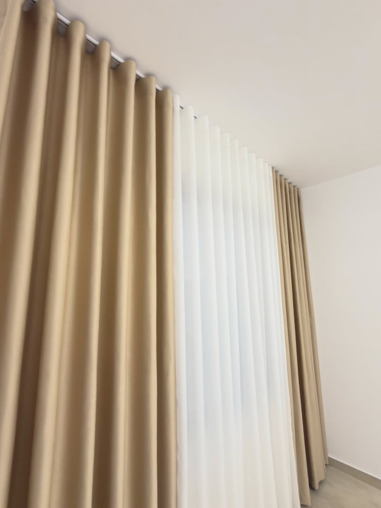

ليس كل ستارة قديمة تحتاج تغييراً. أحياناً يكفي التنظيف أو إضافة خط شيفون. وهذه طريقة الحكم.

## علامات تستدعي التغيير

- **بهتان الشمس:** جهة النافذة أفتح من الداخل بشكل واضح. شمس الكويت تبهّت القماش مع السنوات، ولا يرجع لونه بالتنظيف.
- **تمزق أو ترقق القماش** خاصة عند الطيات.
- **القماش لا يناسب الأثاث الجديد** بعد تغيير الكنب أو الدهان.

## متى يكفي التعديل؟

- **ستارة متسخة بلا بهتان:** التنظيف يكفي. اقرأ [تنظيف الستائر والعناية بها](/blog/curtain-cleaning-care/).
- **غرفة صارت تحتاج ضوءاً أكثر:** أضف خط شيفون إذا كانت السكة تسمح.
- **السكة تتعطل:** أحياناً المشكلة في السكة وحدها.

## تنبيه

نعدّل ونركّب فقط الستائر التي نفصّلها نحن. إذا كانت ستارتك من مكان آخر، فالأفضل الرجوع لمن فصّلها، أو تفصيل ستارة جديدة.
