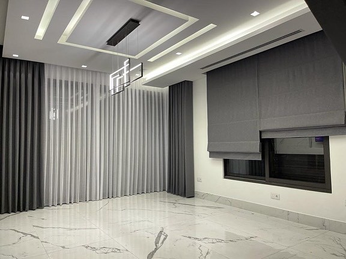

الستارة الرومانية قطعة قماش مسطحة تُرفع بالحبل فتتجمع بطيات أفقية متتالية فوق النافذة. تجمع بين مظهر القماش وبساطة الرول.

## أين تناسب؟

- **النوافذ الجانبية في الصالة** بجانب ستارة الويفي الرئيسية.
- **المطبخ**، حيث لا تريد قماشاً يصل للأرض.
- **النوافذ الصغيرة** التي تبدو ستارة الأرض فيها كبيرة.

شاهد [صالة بستائر شيفون ورومانية في النسيم](/projects/nasim-living-sheer-roman/).

## الروماني أم الرول؟

| | الروماني | [الرول](/curtains/roll/) |
|---|---|---|
| الشكل عند الرفع | طيات قماش | ملفوف على أسطوانة |
| المظهر | أنعم وأقرب للقماش | أبسط وعملي |
| السعر | 7 د.ك/م² | 8 د.ك/م² |

## السعر

**7 د.ك للمتر المربع**: العرض × الارتفاع × 7. مثال: نافذة 1.2 × 1.5 م = 1.8 م² = 12.6 د.ك. اطلع على [الستائر الرومانية](/curtains/roman/).
