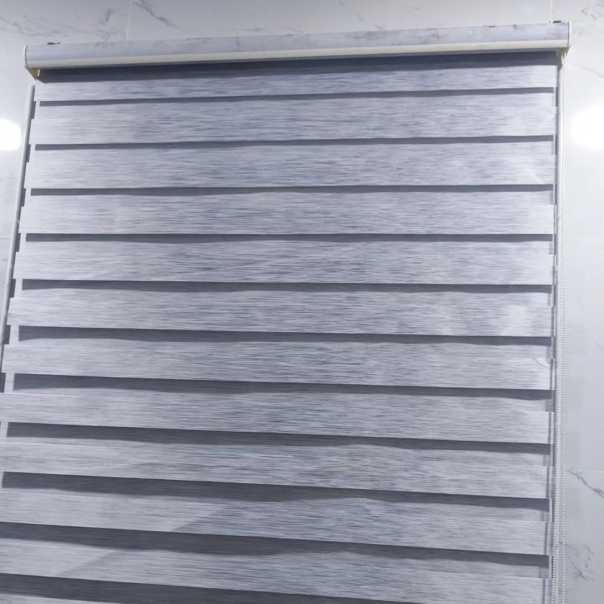

الغرفة المطلة على الشارع أو على نوافذ الجيران تحتاج خصوصية طوال اليوم، دون أن تبقى مظلمة نهاراً.

## الفرق بين النهار والليل

- **نهاراً** يكون الخارج أكثر إضاءة، فالقماش الخفيف يخفف الرؤية إلى الداخل.
- **ليلاً** تنعكس الحالة: إضاءة الغرفة تُظهر الداخل من خلال الشيفون. لذلك تحتاج طبقة معتمة ليلاً.

## ثلاثة حلول

### 1. ويفي خطين

خط [شيفون](/curtains/sheer/) نهاراً، وخط قماش أو [بلاك اوت](/curtains/blackout/) ليلاً. **19 د.ك للمتر الطولي**. شرحناه في [السكة المزدوجة](/blog/double-track-with-sheer/).

### 2. الزيبرا

خطوط شفافة ومعتمة تتحرك فوق بعضها، فتضبط الضوء والخصوصية بحبل واحد. **9 د.ك للمتر المربع**. شاهد [الزيبرا](/curtains/zebra/).

### 3. رول مع ستارة قماش

رول شفاف للنهار داخل فتحة النافذة، وستارة قماش أمامه لليل.

## نصيحة

اجعل الستارة أعرض من النافذة بقليل من الجانبين، حتى لا تظهر فتحات عند الأطراف.
