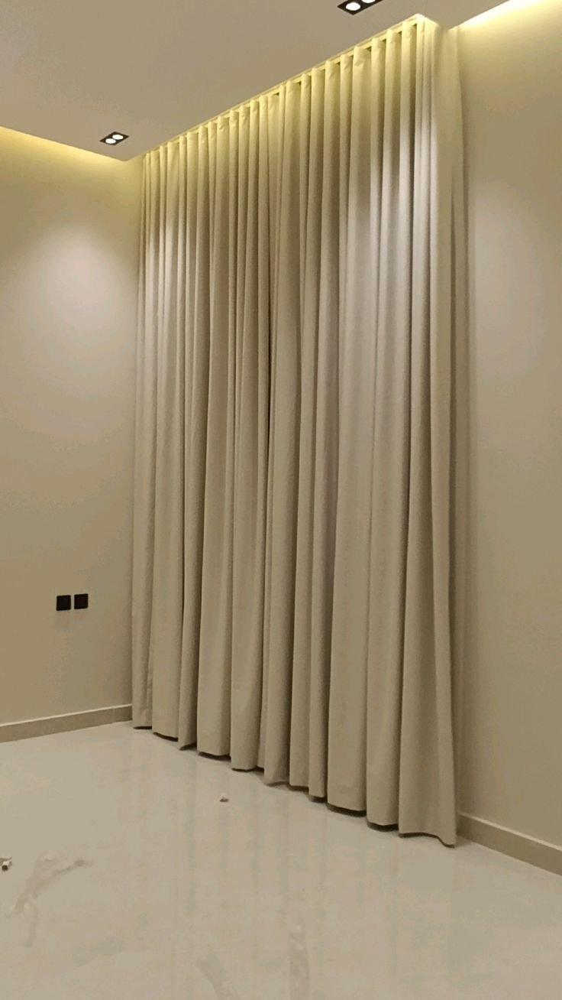

شتاء الكويت قصير، لكن لياليه باردة في بعض الأسابيع، والنوافذ الزجاجية الكبيرة تُدخل البرودة إلى الغرفة. فهل تحتاج ستارة أسمك؟

## ماذا تفعل الستارة السميكة في الشتاء؟

عند إغلاقها ليلاً تصنع طبقة هواء بين الزجاج والغرفة، فتقل البرودة القادمة من النافذة. الأثر محدود لكنه ملحوظ في النوافذ الكبيرة وغرف النوم. ولا نَعِد بدرجة حرارة معينة.

## ستارة واحدة للفصلين

الستارة التي تفيد في الشتاء هي نفسها التي تفيد في الصيف: قماش كثيف أو [بلاك اوت](/curtains/blackout/). في الصيف تقلل حرارة الشمس، وفي الشتاء تقلل برودة الليل. لذلك لا تحتاج تغيير ستائرك مع الفصول. وشرحنا الصيف في [البلاك اوت وحرارة الشمس](/blog/blackout-sun-heat/).

## نصائح للشتاء

- أغلق الستارة بعد غروب الشمس، وافتحها نهاراً ليدخل الدفء.
- اجعل الستارة أعرض من النافذة وتصل للأرض، حتى لا يتسرب الهواء من الأطراف.
- القماش التركي الكتان الذي نستخدمه كثيف بطبيعته، ويمكن تبطينه للغرف التي تحتاج عتمة.

## الأسعار

- ويفي بلاك اوت خط واحد: **12 د.ك للمتر الطولي**.
- بلاك اوت مع شيفون: **19 د.ك للمتر الطولي**.
- رول بلاك اوت: **8 د.ك للمتر المربع**.
