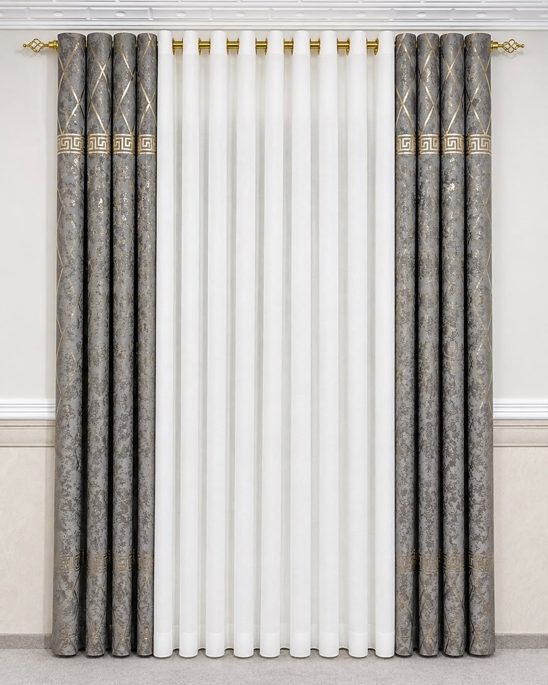
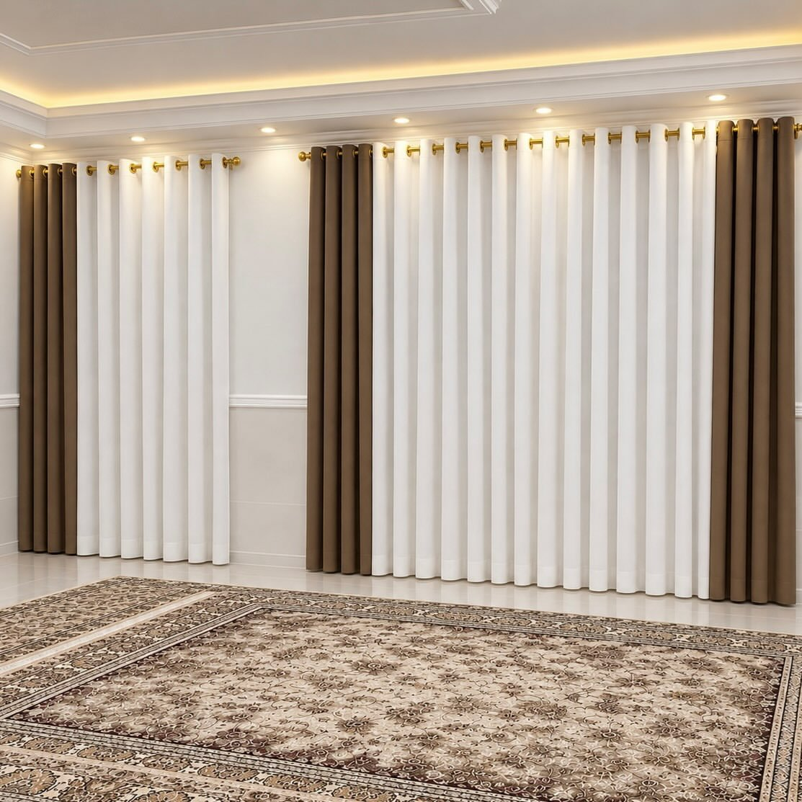

ستائر الحلقات (وتُكتب أيضاً «ستاير حلقات») ستائر قماش في أعلاها ثقوب معدنية تمر عبر عمود ظاهر فوق النافذة، فيصير العمود والحلقات جزءاً من شكل الستارة. نفصّلها في الكويت حسب مقاس نافذتك بسعر **6 د.ك للمتر المربع** شاملاً القماش والعمود والتفصيل.

## لمن تناسب ستائر الحلقات؟

- **المجالس والصالات الكلاسيكية:** تبرز مع العمود الذهبي والأقمشة المنقوشة والكرانيش.
- **النوافذ التي فوقها مكان لعمود ظاهر:** الحلقات لا تعمل على السكة.
- **من يفضّل مظهر العمود والطيات الكبيرة** على الطيات الموجية المتساوية.

وإن كانت الستارة ستُركَّب داخل كورنيش جبس مخفي، أو أردت طيات متساوية على طول الجدار، فالأنسب [ستائر الويفي](/curtains/wave/).

## من أعمالنا بستائر الحلقات

في صالة بالأحمدي فصّلنا ستائر حلقات رمادية بنقشة ذهبية وإطار يوناني على الجانبين، مع شيفون أبيض في الوسط على عمود ذهبي:

وفي مجلس بالفروانية ستائر حلقات بيضاء بأطراف بنية على أعمدة ذهبية تمتد على جدارين:

تفاصيل العملين في [حلقات رمادية بنقشة ذهبية في الأحمدي](/projects/ahmadi-eyelet-grey-gold/) و[حلقات بنية وبيضاء لمجلس في الفروانية](/projects/farwaniya-eyelet-brown-white-majlis/).

## الحلقات أم الويفي؟

| | حلقات | ويفي |
|---|---|---|
| التعليق | عمود ظاهر | سكة (يمكن إخفاؤها في الجبس) |
| الطيات | أكبر وأقل انتظاماً | متساوية وثابتة |
| السعر | 6 د.ك للمتر المربع | 12 د.ك للمتر الطولي (19 للخطين مع الشيفون) |

المقارنة كاملة في [ستائر ويفي أم حلقات؟](/blog/wave-vs-eyelet-curtains/).

## السعر والطلب

ستائر الحلقات تُحسب بالمتر المربع (العرض × الارتفاع): نافذة 2 × 2.5 م مساحتها 5 م²، فسعرها 30 د.ك. والتركيب مجاني عند طلب 5 ستائر فأكثر، وأقل من ذلك يُضاف 5 د.ك لتركيب كل ستارة. والتنفيذ من يومين إلى 3 أيام حسب الكمية.

الزيارة المنزلية لأخذ المقاسات وعرض العينات **مجانية** (عدا العبدلي والصبية فالمعاينة فيهما مدفوعة)، ونوفّر الأقمشة بكل أنواع الخيوط. قدّر المبلغ من [حاسبة الأسعار](/prices/)، أو أرسل صورة النافذة ومقاسها التقريبي عبر واتساب لعرض سعر مبدئي.
