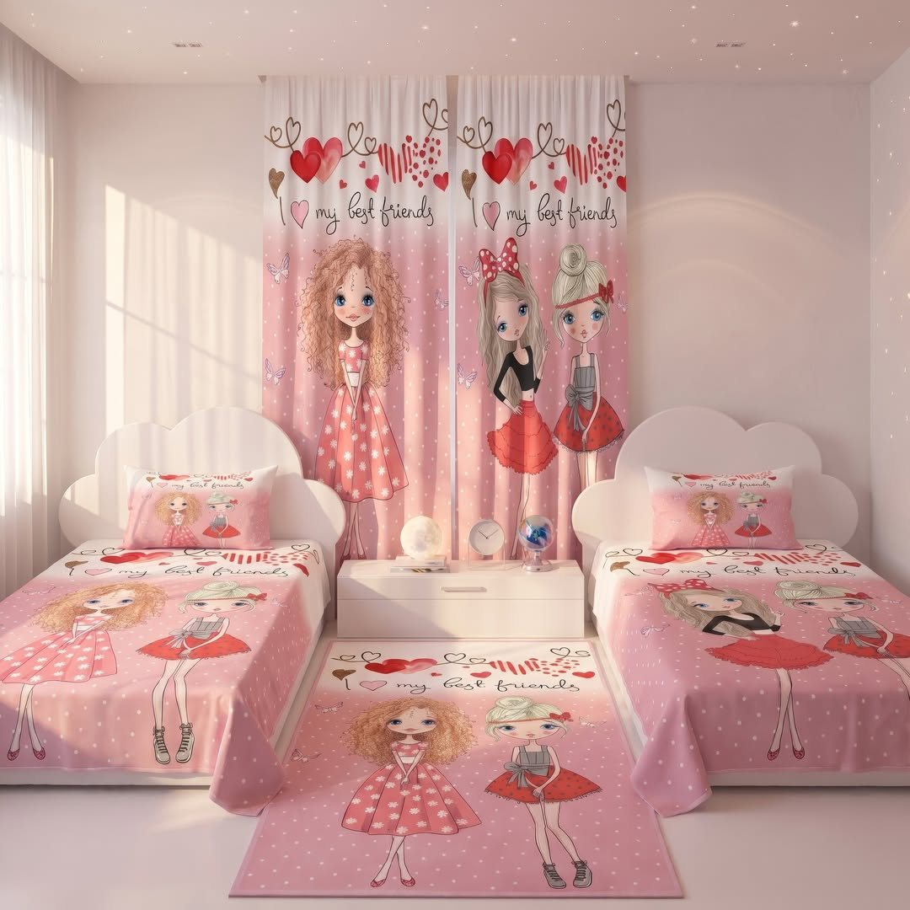
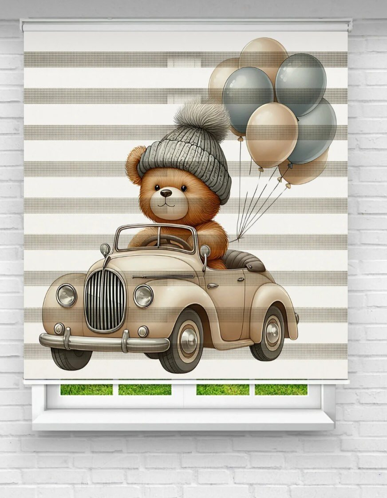
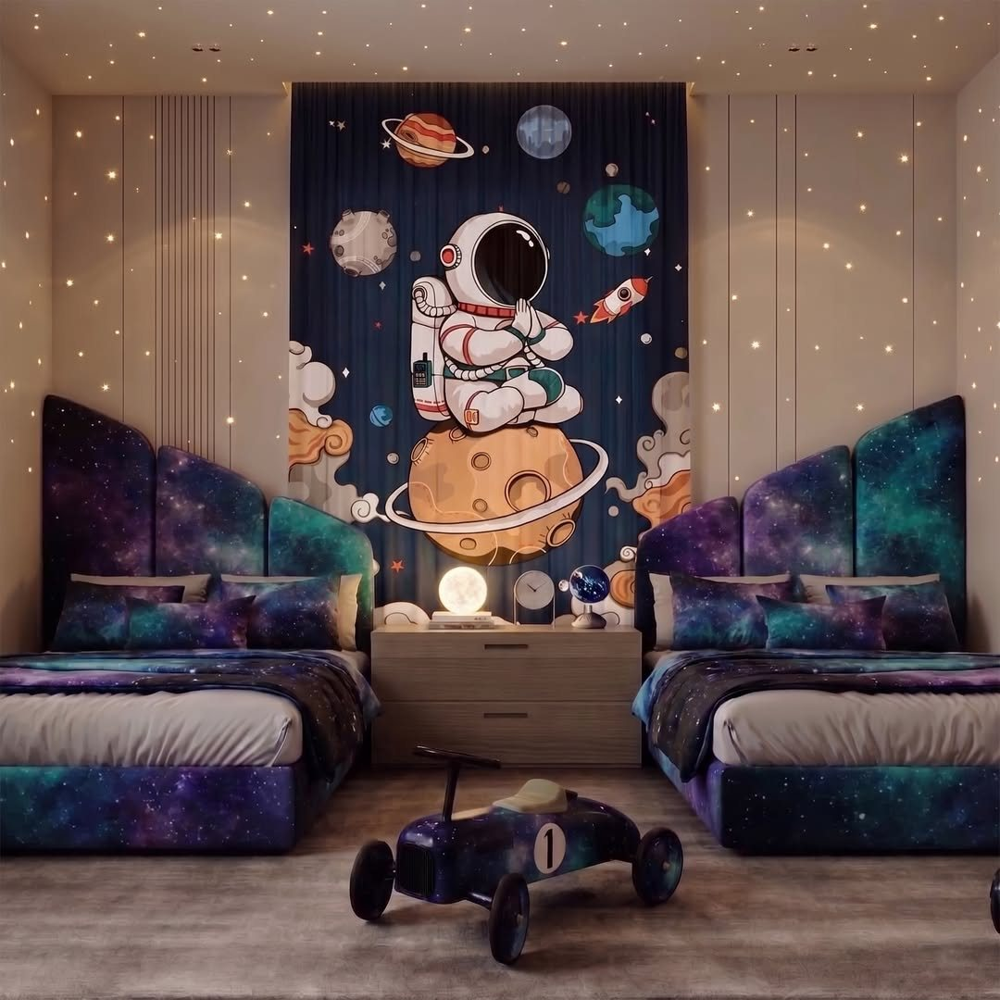
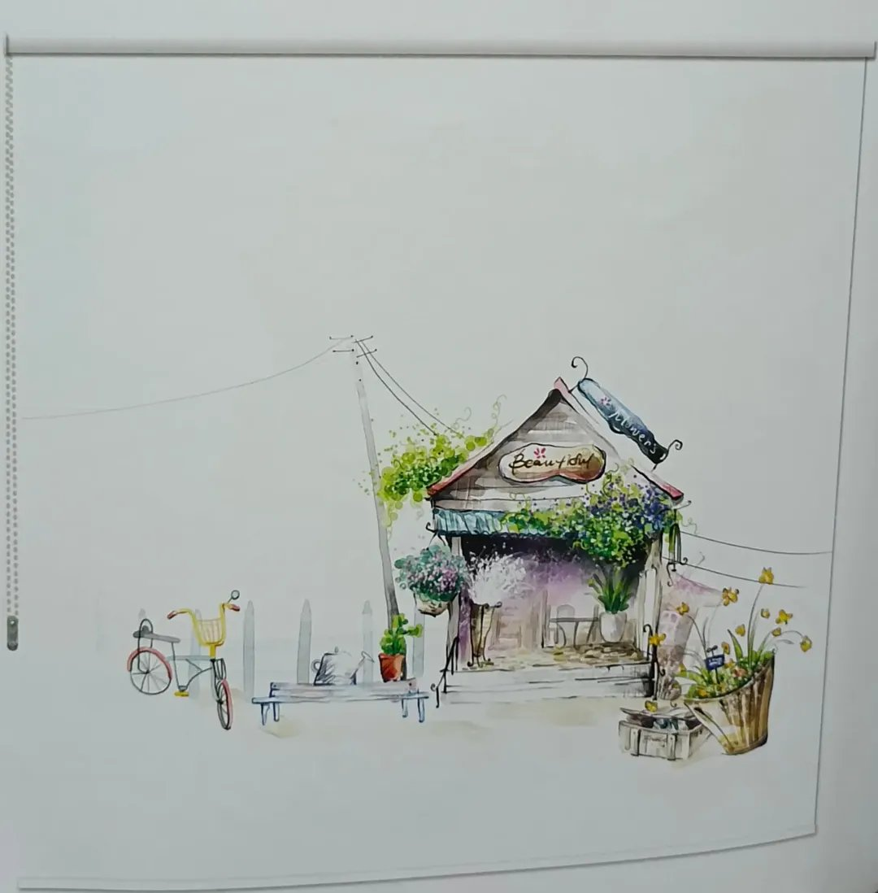
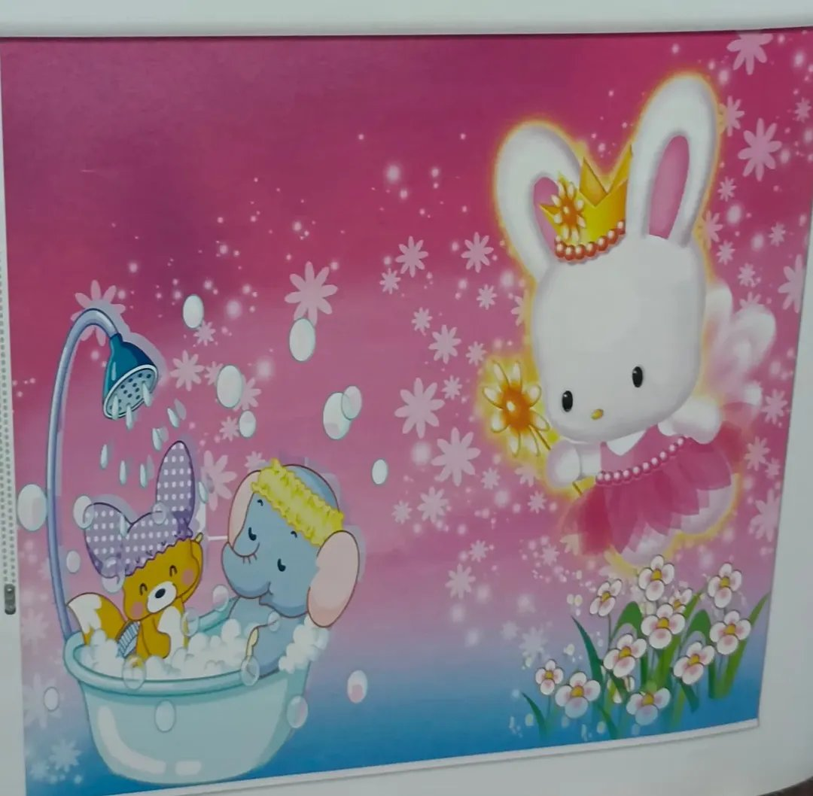

ستائر الأطفال عندنا بتصاميم مطبوعة، وتُنفَّذ **حسب الطلب**: أخبرنا بالتصميم الذي يناسب غرفة طفلك ونطبعه على الستارة، للأولاد أو البنات أو الغرف المشتركة.

نقدّمها بشكلين: **ستائر رول بطبقتين** بتصميم مطبوع (شرائح شفافة وشرائح معتمة تتحكم بها بالإضاءة)، و**ستائر قماش بألواح مطبوعة** تغطي الجدار خلف الأسرّة.

## نماذج من تصاميمنا

**رول مطبوع بطبقة واحدة:** إلى جانب الرول بطبقتين، نطبع التصميم على ستارة رول عادية بطبقة واحدة، فيظهر الرسم كاملاً عند إنزالها، مثل الرسمة المائية الهادئة أو الخلفية الوردية بالحيوانات.

التصاميم المعروضة نماذج، ويمكن تنفيذ تصميم آخر حسب طلبك.

## سعر ستائر الأطفال وطريقة الطلب

تبدأ أسعار ستائر الأطفال من 6 د.ك للمتر المربع، أما **الرول بطباعة تصميم مخصص** حسب طلبك فسعره 13 د.ك للمتر المربع. أرسل لنا التصميم الذي تريده ومقاس النافذة عبر واتساب. الزيارة المنزلية وأخذ المقاسات وعرض العينات **مجانية** (عدا العبدلي والصبية فالمعاينة فيهما مدفوعة)، وأسعارنا تُحسب بالمتر المربع والسعر شامل القماش والسكة والتفصيل. والتركيب مجاني عند طلب 5 ستائر فأكثر، وأقل من ذلك يُضاف 5 د.ك لتركيب كل ستارة.

تعرّف أيضاً على [ستائر الرول](/curtains/roll/) و[خدمة تفصيل الستائر](/services/tailoring/).
