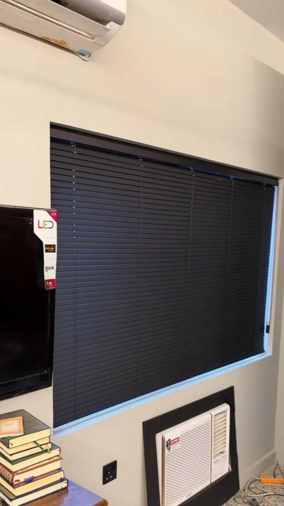
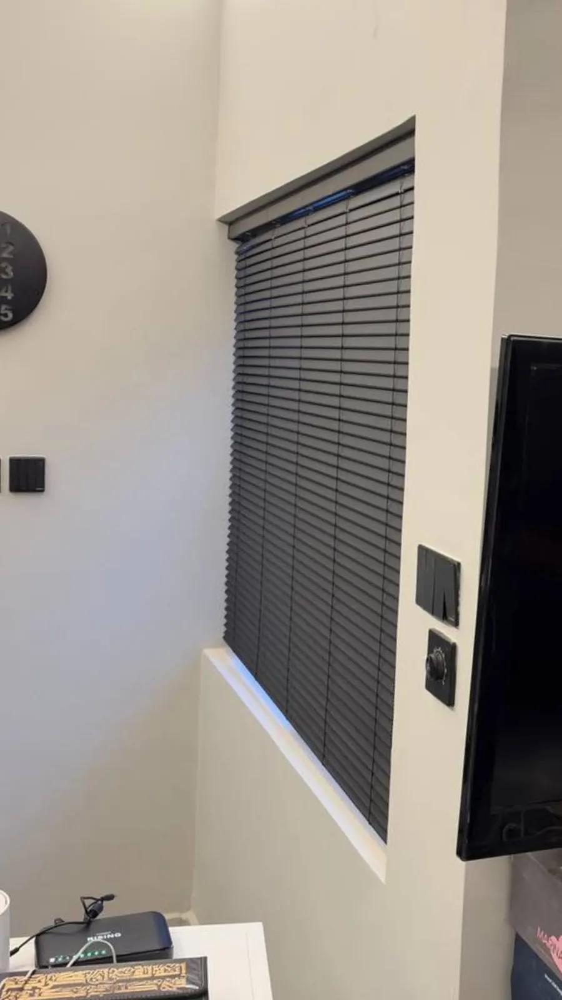
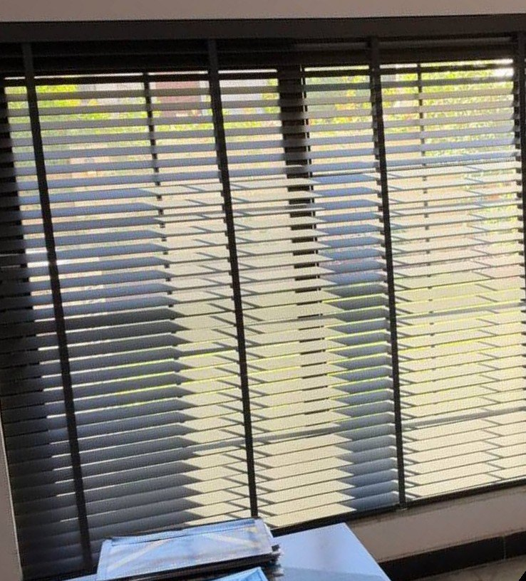

ستائر الشتر المعدنية (وتُسمى أيضاً «ستائر معدنية» أو «ستائر ألمنيوم» أو «شتر داخلي») شرائح ألمنيوم أفقية تُدار بعصا لتغيير زاويتها، فتتحكم بكمية الضوء والخصوصية دون رفع الستارة، وتُرفع كاملة بالحبل عند الحاجة. نفصّلها في الكويت حسب مقاس نافذتك بسعر **15 د.ك للمتر المربع**.

## لمن تناسب الستائر المعدنية؟

- **المكاتب والعيادات:** تنظّم الضوء على الشاشات وتبقى مرتبة مع كثرة الاستعمال.
- **المطابخ والحمامات:** الألمنيوم لا يتأثر بالرطوبة ويُمسح بسهولة.
- **غرف النوم والمعيشة:** تُغلق الشرائح للخصوصية، وتُمال لضوء خفيف نهاراً.
- **النوافذ داخل فتحة عميقة في الجدار:** تُركَّب داخل الفتحة فيبقى الجدار نظيفاً.

وهي شتر داخلي يُركَّب داخل الغرفة، ولا نقدّم شتر الواجهات الخارجية.

## من أعمالنا

في غرفة بنوافذ داخل فتحات الجدار ركّبنا ستائر ألمنيوم رمادية غامقة، كل ستارة مفصّلة على مقاس فتحتها:

وفي مكتب، ستارة ألمنيوم سوداء بشرائح مفتوحة تُدخل ضوء النهار وتخفف وهجه على المكتب:

التفاصيل في [ستائر معدنية ألمنيوم رمادي غامق لغرفة](/projects/sataer-maadaniya-aluminium-ramadi-ghamiq-work/) و[ستائر معدنية ألمنيوم سوداء لمكتب](/projects/sataer-maadaniya-aluminium-aswad-maktab-work/).

## كيف تتحكم بالضوء؟

- **شرائح مفتوحة:** يدخل الضوء ويظهر ما خلف النافذة.
- **شرائح مائلة:** خصوصية من الخارج مع ضوء خفيف.
- **شرائح مغلقة:** حجب معظم الضوء، ويبقى خيط رفيع بين الشرائح، فليست تعتيماً كاملاً مثل [البلاك اوت](/curtains/blackout/).

## المعدنية أم الخشبية أم الرول؟

| | معدنية (ألمنيوم) | [خشبية](/curtains/wooden/) | [رول](/curtains/roll/) |
|---|---|---|---|
| الخامة | شرائح ألمنيوم | شرائح خشب | قماش مسطّح |
| الرطوبة | لا تتأثر | يتأثر الخشب بالماء | يُمسح بسهولة |
| التحكم بالضوء | بزاوية الشرائح | بزاوية الشرائح | بالرفع والإنزال |
| السعر | 15 د.ك/م² | 13 د.ك/م² | 8 د.ك/م² |

## السعر والطلب

السعر **15 د.ك للمتر المربع**: نافذة 1.5 × 1.5 م مساحتها 2.25 م²، فسعرها 33.75 د.ك. والتركيب مجاني عند طلب 5 ستائر فأكثر، وأقل من ذلك يُضاف 5 د.ك لتركيب كل ستارة، والتنفيذ من يومين إلى 3 أيام حسب الكمية.

الزيارة المنزلية لأخذ المقاسات **مجانية** (عدا العبدلي والصبية فالمعاينة فيهما مدفوعة). أرسل صورة النافذة ومقاسها التقريبي عبر واتساب لعرض سعر مبدئي، أو راجع [جدول الأسعار](/prices/).
