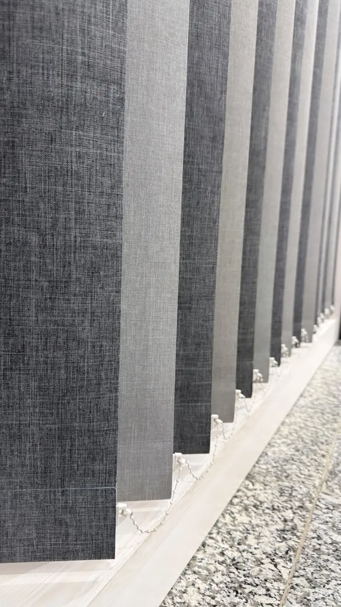

**الستائر العمودية الشريطية**، أو **ستائر فيرتكال** و«الشرائح الطولية» كما يسميها كثيرون، شرائح قماش طولية معلقة على سكة علوية. بحركة الحبل تدور الشرائح لتغيير زاويتها فتتحكم بكمية الضوء والخصوصية، وبحبل آخر تنسحب كلها إلى جانب واحد. نفصّلها في الكويت حسب مقاس نافذتك بسعر **12 د.ك للمتر المربع**.

## أين تناسب الستائر العمودية؟

- **المكاتب والشركات:** تغطي الواجهات الزجاجية والنوافذ العريضة من السقف إلى الأرض، وتخفف انعكاس الضوء على الشاشات.
- **العيادات وغرف الانتظار:** خصوصية مع ضوء نهار مخفف.
- **البيوت:** للصالات والممرات والنوافذ الطويلة، بألوان غامقة أو فاتحة حسب الأثاث.

## العمودية أم الرول أم الزيبرا؟

| النوع | طريقة الفتح | الأنسب لـ | السعر |
|---|---|---|---|
| عمودية شريطية | تدور الشرائح وتنسحب جانبًا | الواجهات الزجاجية والنوافذ العريضة والطويلة | 12 د.ك/م² |
| [رول](/curtains/roll/) | ترتفع وتنزل | النوافذ العادية | 8 د.ك/م² |
| [زيبرا](/curtains/zebra/) | تتطابق الشرائح الأفقية | غرف النوم والصالات | 9 د.ك/م² |

للمكاتب التي تفضّل الرول، شاهد [الستائر المكتبية](/curtains/office/).

## الألوان

نوفّرها بالأبيض والكريمي والبيج والرمادي الفاتح والغامق والكحلي والبني، وبقماش بلونين متناوبين. شاهد الألوان والتركيبات في [كتالوج الستائر العمودية الشريطية](/products/sataer-amudiya-sharitiya-katalog/)، ومن أعمالنا: [ستائر عمودية لمكاتب وشركات](/projects/sataer-amudiya-makatib-work/) و[ستائر عمودية لبيوت](/projects/sataer-amudiya-buyut-work/).
