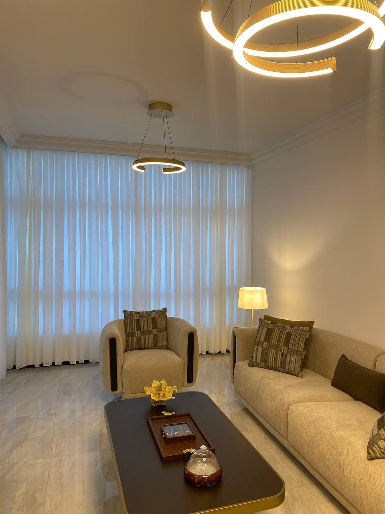

نقدّم تفصيل وتركيب ستائر في الكويت منذ 2012: نأخذ المقاس، ونفصّل الستارة في ورشتنا، ثم يركّبها فني التركيب في منزلك أو مكتبك في أي محافظة. التركيب مجاني عند طلب 5 ستائر فأكثر، وأقل من ذلك 5 د.ك لكل ستارة، ويستغرق التنفيذ من يومين إلى 3 أيام حسب الكمية.

**تنبيه قبل الطلب:** نركّب الستائر التي نفصّلها نحن فقط، ولا نقدّم تركيباً منفصلاً لستائر اشتُريت من مكان آخر، لأن التركيب جزء من التفصيل على المقاس.

## ماذا نركّب؟

- ستائر القماش على السكة، ومنها [ستائر الويفي](/curtains/wave/) و[ويفي مع شيفون](/wave-curtains/) و[ستائر الشيفون](/curtains/sheer/).
- [ستائر الرول](/curtains/roll/) و[البلاك أوت](/curtains/blackout/) و[ستائر الأطفال](/curtains/kids/).
- [الستائر الخشبية](/curtains/wooden/) (بليندات).

## كيف يختلف التركيب حسب نوع الستارة؟

- **الويفي:** تُعلَّق الستارة على سكة خاصة تعطي طيّات موجية متساوية، فنركّب السكة أولاً ثم نعلّق الستارة ونضبط توزيع الطيّات.
- **الرول:** القماش يُلَفّ على أنبوب في أعلى النافذة، فنثبّت الأنبوب ونجرّب النزول والرفع معك.
- **الخشبي:** يُركّب داخل فتحة النافذة لمظهر أنظف، أو على الجدار فوقها ليغطي النافذة كاملة ويقلل تسرب الضوء من الأطراف.
- **البلاك أوت:** قد يظهر خيط ضوء رفيع عند الأطراف، ويتأثر ذلك بمقاس الستارة وموضع تركيبها.

نحدد طريقة التركيب المناسبة لنافذتك في زيارة أخذ المقاسات.

## كم يكلف التركيب؟

سعر المتر المربع يشمل القماش والسكة والتفصيل. والتركيب لكل الأنواع مجاني عند طلب 5 ستائر فأكثر، وأقل من ذلك يُضاف 5 د.ك لتركيب كل ستارة. مثلاً: طلب 3 ستائر يضيف 15 د.ك للتركيب، وطلب 5 ستائر تركيبها مجاني. جرّب [حاسبة الأسعار](/prices/) لتقدير المبلغ.

## كيف يتم التركيب؟

1. بعد [تفصيل الستائر](/services/tailoring/) على مقاس نافذتك نتفق معك على موعد التركيب.
2. نركّب السكة أو الرول في موقعك.
3. نعلّق الستارة ونجرّب حركتها معك قبل أن نغادر.

لتسهيل العمل، يفضّل إخلاء المساحة أمام النافذة قبل الموعد.

## مناطق التركيب

نركّب في المحافظات الست: العاصمة وحولي والفروانية ومبارك الكبير والأحمدي والجهراء، ولا نستثني منطقة. راجع [مناطق الخدمة](/areas/).

## أسئلة شائعة

**هل التركيب مجاني؟** نعم عند طلب 5 ستائر فأكثر، وهذا ينطبق على كل الأنواع. وأقل من ذلك يُضاف 5 د.ك لتركيب كل ستارة.

**هل أحتاج زيارة قبل التركيب؟** الزيارة المنزلية لأخذ المقاسات وعرض العينات مجانية، عدا العبدلي والصبية فالمعاينة فيهما مدفوعة. ويمكنك أيضاً إرسال صورة النافذة والمقاس التقريبي عبر واتساب لعرض مبدئي.

**هل تركّبون ستائر اشتريتها من مكان آخر؟** لا، نركّب الستائر التي نفصّلها نحن فقط، لأن التركيب جزء من التفصيل على المقاس.

**كم يستغرق الطلب حتى التركيب؟** من يومين إلى 3 أيام حسب الكمية.

**ماذا لو ظهر عيب بعد التركيب؟** الضمان 3 أيام ويشمل التعديلات المطلوبة عند وجود عيب مصنعي، وبلا إرجاع. التفاصيل في [الضمان والاسترجاع](/warranty/).

لمعرفة المزيد عنا اقرأ [من نحن](/about/)، وللأسئلة الأخرى راجع [الأسئلة الشائعة](/faq/).
