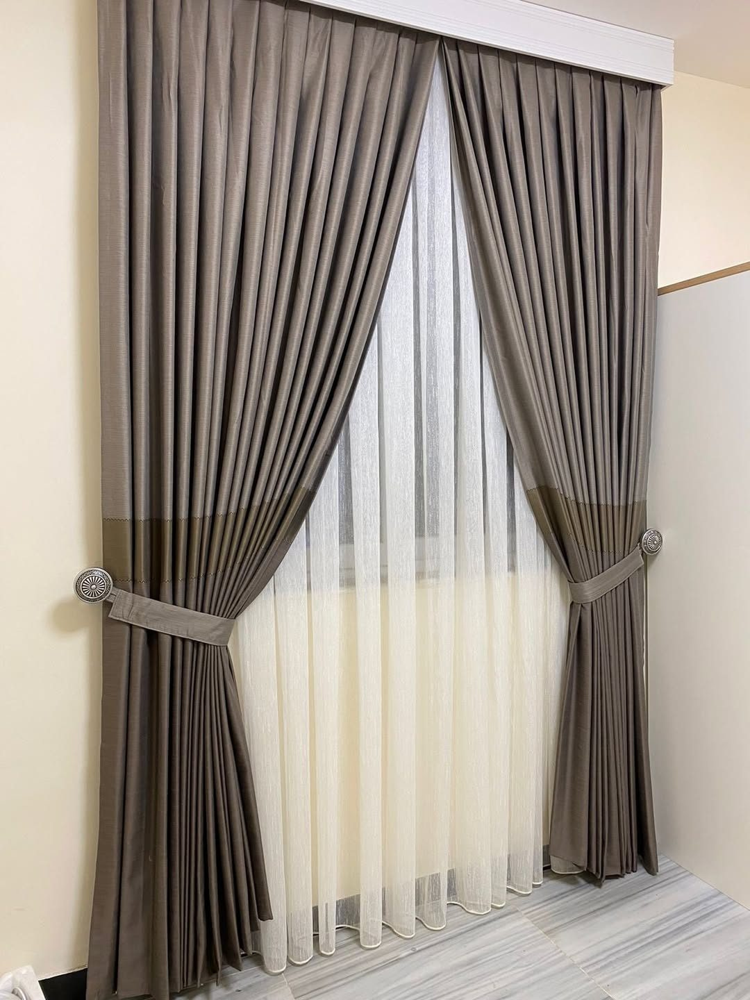

نفصّل الستائر على مقاس نافذتك: نأخذ المقاس في منزلك أو نكتفي بصورة النافذة والمقاس التقريبي عبر واتساب، ثم نرسل لك عرض سعر مبدئي. **زيارة أخذ المقاسات وعرض العينات مجانية** (عدا العبدلي والصبية فالمعاينة فيهما مدفوعة)، والتنفيذ يستغرق من يومين إلى 3 أيام حسب الكمية.

نفصّل الستائر منذ 2012 في ورشتنا في الضجيج، ونخدم جميع مناطق الكويت، ونفصّل جميع أنواع الستائر عدا الكهربائية، سواء كنت تكتبها «تفصيل ستائر» أو «تفصيل ستاير» أو تسميها «تفصال ستائر» أو «برادي» كما يقول كثيرون في الكويت.

## تفصال ستائر وبرادي في الكويت

البرادي هو الاسم الكويتي الشائع للستائر القماشية، والتفصال هو تفصيلها على مقاس النافذة. نفصّل البرادي بكل أنواعها: [الويفي](/curtains/wave/) والحلقات، ومعها طبقة [الشيفون](/curtains/sheer/) أو [البلاك اوت](/curtains/blackout/)، وكذلك الرول و[الزيبرا (ليلي نهاري)](/curtains/zebra/) والخشبي، بأقمشة تركية وبكل أنواع الخيوط.

## ماذا يشمل سعر التفصيل؟

السعر بالمتر المربع شامل ثلاثة أشياء: **القماش، والسكة، والتفصيل**، فلا تدفع للسكة أو للخياطة مبلغاً منفصلاً. يبقى التركيب وحده بشرط واضح: مجاني عند طلب 5 ستائر فأكثر، وأقل من ذلك 5 د.ك لكل ستارة.

## الأقمشة والخيوط

أقمشتنا تركية، ونوفّر الأقمشة بكل أنواع الخيوط، فتختار السماكة واللمسة واللون المناسب لكل غرفة. ونعرض العينات عليك في زيارة القياس لتراها على الطبيعة وفي إضاءة غرفتك قبل التفصيل.

## كيف تتم الخطوات

1. **القياس:** نزور منزلك لأخذ المقاسات وعرض العينات، أو ترسل لنا صورة النافذة ومقاسها التقريبي لنبدأ بعرض مبدئي.
2. **اختيار النوع والقماش:** تختار النوع واللون والقماش، ونحدد معك الطول المناسب للغرفة. أقمشتنا تركية.
3. **التفصيل:** تُفصَّل الستارة في ورشتنا في الضجيج على المقاس المتفق عليه.
4. **التركيب:** نركّب الستارة في موقعك، فالخدمة تفصيل وتركيب ستائر في طلب واحد، وتجد التفاصيل في صفحة [تركيب الستائر](/services/installation/).

## كم يكلف التفصيل؟

السعر بالمتر المربع (العرض × الارتفاع) ويشمل القماش والسكة والتفصيل: من 5 د.ك للشيفون، و6 د.ك للرول والويفي والحلقات والبلاك اوت والأطفال والمكتبي، و7 د.ك للويفي مع الشيفون (الخام)، و9 د.ك للخام بلاك اوت مع شيفون، و13 د.ك للخشبي. والتركيب لكل الأنواع مجاني عند طلب 5 ستائر فأكثر، وأقل من ذلك يُضاف 5 د.ك لكل ستارة. يمكنك تقدير مبلغ نافذتك من [حاسبة الأسعار](/prices/). وللتفاصيل اقرأ [كيف تقيس نافذتك قبل طلب الستائر؟](/blog/how-to-measure-window/) و[كيف تحسب تكلفة تفصيل الستائر؟](/blog/curtain-cost-kuwait/).

## تفصيل ستائر الحلقات والويفي

نفصّل ستائر الحلقات (Eyelet) التي تُعلّق بحلقات معدنية على عمود ظاهر لمظهر كلاسيكي، و[ستائر الويفي](/curtains/wave/) على سكة خاصة لطيات موجية متساوية، ويمكن إضافة طبقة شيفون أو بلاك اوت خلف أي منهما. وإن لم تكن متأكداً من النوع، نقترح عليك الأنسب لكل غرفة في زيارة القياس.

## متى تختار المفصّل ومتى الجاهز؟

الجاهز يأتي بمقاسات ثابتة، وقد يترك فراغاً أو يزيد عن النافذة. أما المفصّل فيُصنع على مقاس نافذتك الفعلي. وإن كان الجاهز يناسبك فلدينا [ستائر رول جاهزة](/ready-roll-curtains/).

للمقارنة بالتفصيل، اقرأ [الستائر الجاهزة أم التفصيل حسب المقاس؟](/blog/ready-vs-tailored-curtains/)، ولمعرفة ما يرفع السعر أو يخفضه اقرأ [ما الذي يؤثر على سعر الستائر؟](/blog/what-affects-curtain-price/).

## الأنواع التي نفصّلها

- [ستائر رول](/curtains/roll/) للمكاتب والمطابخ وغرف المعيشة.
- [ستائر بلاك اوت](/curtains/blackout/) لغرف النوم.
- [ستائر ويفي](/curtains/wave/) و[ويفي مع شيفون](/wave-curtains/) للصالات والمجالس.
- [ستائر شيفون](/curtains/sheer/) و[ستائر أطفال](/curtains/kids/) و[ستائر خشبية](/curtains/wooden/).

## أسئلة شائعة

**هل يمكن طلب التفصيل بدون زيارة؟** نعم، أرسل صورة النافذة والمقاس التقريبي عبر واتساب لعرض مبدئي، ونحدد موعد القياس قبل التنفيذ.

**كم تستغرق مدة التنفيذ؟** من يومين إلى 3 أيام حسب الكمية.

**هل يوجد ضمان؟** نعم، ضمان 3 أيام يشمل التعديلات المطلوبة عند وجود عيوب مصنعية، وبلا إرجاع. التفاصيل في [الضمان والاسترجاع](/warranty/).

**هل تخدمون منطقتي؟** نخدم جميع مناطق الكويت، وأكثر طلباتنا في الجهراء والعاصمة ومبارك الكبير وحولي. راجع [مناطق الخدمة](/areas/).

**هل يمكن إلغاء الطلب؟** يمكن إلغاء الطلب بعد دفع العربون ما دام التفصيل لم يبدأ، ولا يمكن إلغاؤه بعد البدء بالتفصيل لأن الستارة تُقص على مقاس نافذتك.

**ما أوقات التواصل؟** يومياً من 8 صباحاً حتى 10 مساءً عبر واتساب أو الاتصال، ولدينا موظف يتحدث الإنجليزية.

**أين أرى أعمالاً نفذتموها؟** في صفحة [أعمالنا](/projects/) صور ستائر فصّلناها وركّبناها في بيوت ومكاتب بالكويت.

لأسئلة أخرى راجع [الأسئلة الشائعة](/faq/)، وتعرّف علينا في [من نحن](/about/)، أو [تواصل معنا](/contact/) مباشرة.
